# Adventure Camp Management System (ACMS)
## Comprehensive Object-Oriented Programming (OOP) Project Report

---

## 1. Executive Summary & Project Overview

The **Adventure Camp Management System (ACMS)** is an Object-Oriented Software Application developed in Java for managing the end-to-end operations of an outdoor adventure camp. The system provides an interactive command-line interface (CLI) and an underlying domain model to administer participants, instructors, adventure locations, specialized outdoor activities, scheduling, equipment inventory, safety inspections, activity registrations, participant attendance, and post-activity feedback.

### Key Objectives
- Model real-world camp operations into a clean, decoupled, and extensible object-oriented design.
- Demonstrate mastery of fundamental and advanced OOP concepts:
  - **Encapsulation:** Strong data-hiding via private fields with controlled public accessors and mutators.
  - **Inheritance:** Hierarchical code reuse (`Person` &rarr; `Participant`/`Instructor`/`AdminStaff`; `Activity` &rarr; `AdventureActivity`/`WaterActivity`/`TeamBuildingActivity`; `Equipment` &rarr; `SafetyEquipment`/`SportsEquipment`).
  - **Polymorphism:** Runtime dynamic method dispatch via abstract methods (`displayInfo()`, `conductActivity()`, `checkCondition()`) and interface implementations.
  - **Abstraction:** Decoupling behavior and contracts via abstract classes and interfaces (`Schedulable`, `Notifiable`).
  - **Generics:** Reusable data management via a custom `Repository<T>` container.
  - **Functional Programming & Streams:** Widespread application of Java 8+ lambdas, predicates, consumers, comparators, and method references.
  - **Custom Exception Hierarchy:** Domain-specific checked exceptions rooted at `CampException`.
  - **Data Persistence:** Robust comma-separated value (CSV) file storage orchestrated by `DataManager`.

---

## 2. System Architecture & Class Hierarchy Diagram

```mermaid
classDiagram
    direction TB

    %% People Hierarchy
    class Person {
        <<abstract>>
        -String id
        -String name
        -int age
        -String contactNumber
        +displayInfo()* void
    }
    class Participant {
        -String emergencyContact
        -String medicalNotes
        -String skillLevel
        -List~Registration~ registrations
        +displayInfo() void
    }
    class Instructor {
        -String specialization
        -List~String~ certifications
        -boolean isAvailable
        -List~Activity~ assignedActivities
        +displayInfo() void
        +sendNotification(String) void
    }
    class AdminStaff {
        -String role
        +displayInfo() void
        +sendNotification(String) void
    }
    Person <|-- Participant
    Person <|-- Instructor
    Person <|-- AdminStaff

    %% Interfaces
    class Notifiable {
        <<interface>>
        +sendNotification(String) void
    }
    class Schedulable {
        <<interface>>
        +getStartTime() LocalDateTime
        +getEndTime() LocalDateTime
        +updateSchedule(LocalDateTime) void
    }
    Notifiable <|.. Instructor
    Notifiable <|.. AdminStaff

    %% Activities Hierarchy
    class Activity {
        <<abstract>>
        -String activityId
        -String title
        -String description
        -int durationMinutes
        -int maxParticipants
        -LocalDateTime startTime
        -Location location
        -Instructor instructor
        -List~Participant~ participants
        +conductActivity()* void
    }
    class AdventureActivity {
        -String terrainType
        -String riskLevel
        +conductActivity() void
    }
    class WaterActivity {
        -boolean lifeguardRequired
        -String waterBodyType
        +conductActivity() void
    }
    class TeamBuildingActivity {
        -int teamSize
        +conductActivity() void
    }
    Schedulable <|.. Activity
    Activity <|-- AdventureActivity
    Activity <|-- WaterActivity
    Activity <|-- TeamBuildingActivity

    %% Equipment Hierarchy
    class Equipment {
        <<abstract>>
        -String equipmentId
        -String name
        -boolean isAvailable
        -String condition
        +checkCondition()* void
    }
    class SafetyEquipment {
        -LocalDate lastInspectionDate
        -String safetyRating
        +checkCondition() void
    }
    class SportsEquipment {
        -String sportType
        +checkCondition() void
    }
    Equipment <|-- SafetyEquipment
    Equipment <|-- SportsEquipment

    %% Management Aggregate
    class Camp {
        -String campId
        -String campName
        -int capacity
        -Repository~Registration~ registrations
        -Repository~Participant~ participants
        -Repository~Instructor~ instructors
        -Repository~Activity~ activities
        -Repository~Equipment~ equipmentList
        -Repository~Location~ locations
        +registerParticipant(Participant, Activity) void
        +scheduleActivity(Activity, LocalDateTime) void
    }
    class Registration {
        -String registrationId
        -Participant participant
        -Activity activity
        -LocalDate registrationDate
        -String status
        +displayInfo() void
    }
    class Attendance {
        -Repository~AttendanceRecord~ records
        +recordAttendance(AttendanceRecord) void
    }
    class AttendanceRecord {
        -Participant participant
        -Activity activity
        -LocalDate date
        -boolean isPresent
    }
    class CampSchedule {
        -Repository~ScheduleEntry~ entries
        +addEntry(ScheduleEntry) void
    }
    class ScheduleEntry {
        -String entryId
        -Activity activity
        -LocalDateTime startTime
    }

    Camp *-- Registration
    Camp *-- CampSchedule
    Camp *-- Attendance
    Registration --> Participant
    Registration --> Activity
    AttendanceRecord --> Participant
    AttendanceRecord --> Activity
    ScheduleEntry --> Activity
```



---

## 3. Detailed Class-by-Class Breakdown

Below is the exhaustive documentation for all **31 classes and interfaces** utilized across the ACMS codebase, organized by their respective packages.

---

### Package: `people`

#### 1. `Person`
- **Fully Qualified Name:** `people.Person`
- **Class Type:** `public abstract class`
- **Inheritance / Interfaces:** Root class for all individuals in the system.
- **Purpose:** Acts as the foundational abstraction for any human actor in the camp. It captures common personal attributes and defines the polymorphic contract for displaying identification details.
- **Attributes:**
  - `private String id`: Unique identifier (e.g., `P1`, `I1`).
  - `private String name`: Full name of the person.
  - `private int age`: Age in years.
  - `private String contactNumber`: Primary telephone or contact digits.
- **Key Methods:**
  - `public Person(String id, String name, int age, String contactNumber)`: Base constructor.
  - Standard getters (`getId()`, `getName()`, `getAge()`, `getContactNumber()`) and setter (`setContactNumber()`).
  - `public abstract void displayInfo()`: Abstract method enforcing custom representation in subclasses.
- **Relationships:**
  - Generalized parent of `Participant`, `Instructor`, and `AdminStaff`.
- **Where & How Used:**
  - Inherited by all human entities across the system. Ensures polymorphic handling wherever personal identity attributes are required.

---

#### 2. `Participant`
- **Fully Qualified Name:** `people.Participant`
- **Class Type:** `public class`
- **Inheritance / Interfaces:** `extends Person`
- **Purpose:** Represents camp attendees/campers who enroll in camp activities.
- **Attributes:**
  - `private String emergencyContact`: Contact info for emergency situations.
  - `private String medicalNotes`: Allergies or health considerations (e.g., Asthma, Heart condition).
  - `private String skillLevel`: Skill proficiency (`Beginner`, `Intermediate`, `Advanced`).
  - `private List<Registration> registrations`: In-memory list of all activity registrations linked to this participant.
- **Key Methods:**
  - `public Participant(String id, String name, int age, String contactNumber, String emergencyContact, String medicalNotes, String skillLevel)`: Initializes all personal and camper-specific details.
  - `public void addRegistration(Registration r)` / `removeRegistration(Registration r)`: Manages activity registrations.
  - `public boolean isRegisteredFor(Activity activity)`: Stream/lambda check verifying if participant is already registered for a specific activity.
  - `public List<Activity> getRegisteredActivities()`: Uses `map()` and `filter()` streams to retrieve non-null registered activities.
  - `public void displayInfo()`: Overridden method displaying ID, Name, and Skill Level.
- **Relationships:**
  - Inherits from `Person`.
  - Holds an aggregated `List<Registration>`.
  - Associated with `Activity`, `AttendanceRecord`, `Feedback`, and `Registration`.
- **Where & How Used:**
  - Managed in `Camp.participants`.
  - Loaded/saved in `DataManager.loadParticipants()` / `saveParticipants()`.
  - Selected during activity registration, attendance tracking, and feedback in `MainCLI`.

---

#### 3. `Instructor`
- **Fully Qualified Name:** `people.Instructor`
- **Class Type:** `public class`
- **Inheritance / Interfaces:** `extends Person implements Notifiable`
- **Purpose:** Represents qualified camp trainers, coaches, and activity leaders.
- **Attributes:**
  - `private String specialization`: Main area of expertise (e.g., "Water Sports", "Climbing & Ropes").
  - `private List<String> certifications`: Professional badges or credentials (e.g., "Lifeguard", "Wilderness First Aid").
  - `private boolean isAvailable`: Duty availability flag.
  - `private List<Activity> assignedActivities`: In-memory collection of activities led by this instructor.
- **Key Methods:**
  - `public Instructor(String id, String name, int age, String contactNumber, String specialization)`: Parameterized constructor.
  - `public void assignActivity(Activity a)` / `removeActivity(Activity a)`: Manages assigned sessions.
  - `public boolean hasCertification(String certName)`: Lambda-based stream predicate validating instructor credentials.
  - `public List<String> getAssignedActivityTitles()`: Functional mapping of assigned activities to their title strings.
  - `public void sendNotification(String message)`: Implements `Notifiable` to log targeted notices.
  - `public void displayInfo()`: Prints instructor details and specialization.
- **Relationships:**
  - Inherits from `Person`.
  - Implements `Notifiable`.
  - Associated with `Activity` (an activity has one lead instructor).
- **Where & How Used:**
  - Maintained in `Camp.instructors`.
  - Loaded/saved via `DataManager.instructors.csv`.
  - Broadcast target via `Camp.broadcastToInstructors(message)`.
  - Assigned when creating activities in `MainCLI.manageActivities()`.

---

#### 4. `AdminStaff`
- **Fully Qualified Name:** `people.AdminStaff`
- **Class Type:** `public class`
- **Inheritance / Interfaces:** `extends Person implements Notifiable`
- **Purpose:** Represents camp administrative personnel responsible for camp oversight, safety reviews, and system notices.
- **Attributes:**
  - `private String role`: Administrative designation (e.g., "Camp Director", "Safety Officer").
- **Key Methods:**
  - `public AdminStaff(String id, String name, int age, String contactNumber, String role)`: Constructor.
  - `public void displayInfo()`: Prints admin identity and role.
  - `public void sendNotification(String message)`: Implements `Notifiable` interface for alert dispatching.
- **Relationships:**
  - Inherits from `Person`.
  - Implements `Notifiable`.
- **Where & How Used:**
  - Serves as an administrative receiver for camp-wide alerts (`Camp.notifyStaff()`).

---

### Package: `activities`

#### 5. `Activity`
- **Fully Qualified Name:** `activities.Activity`
- **Class Type:** `public abstract class`
- **Inheritance / Interfaces:** `implements Schedulable`
- **Purpose:** Abstract root class for all activities offered at the camp. Encapsulates title, capacity, venue, assigned instructor, enrolled participants, feedback, and equipment allocations.
- **Attributes:**
  - `private String activityId`: Unique identifier (e.g., `A1`, `A2`).
  - `private String title`: Activity title.
  - `private String description`: Overview description.
  - `private int durationMinutes`: Scheduled duration in minutes.
  - `private int maxParticipants`: Maximum camper capacity.
  - `private LocalDateTime startTime`: Session commencement timestamp.
  - `private Location location`: Venue where the activity is hosted.
  - `private Instructor instructor`: Assigned lead instructor.
  - `private List<Participant> participants`: Enrolled campers.
  - `private List<Feedback> feedbackList`: Feedback records submitted for this activity.
  - `private List<EquipmentAllocation> equipmentAllocations`: Equipment items currently or previously reserved.
- **Key Methods:**
  - `public abstract void conductActivity()`: Polymorphic execution method.
  - `public void addParticipant(Participant p)` / `removeParticipant(Participant p)`: Enrolls/removes campers ensuring uniqueness.
  - `public double getAverageRating()`: Lambda stream calculating average feedback score.
  - `public boolean hasParticipant(String participantId)`: Stream search checking enrollment.
  - `public List<EquipmentAllocation> getActiveAllocations()`: Filters equipment allocations where status is `"Allocated"`.
  - `public LocalDateTime getEndTime()`: Computes dynamic completion time (`startTime.plusMinutes(durationMinutes)`).
  - `public void updateSchedule(LocalDateTime startTime)`: Implements `Schedulable` contract.
- **Relationships:**
  - Implements `Schedulable`.
  - Associated with `Location` and `Instructor`.
  - Aggregates `List<Participant>`, `List<Feedback>`, and `List<EquipmentAllocation>`.
  - Base class for `AdventureActivity`, `WaterActivity`, and `TeamBuildingActivity`.
- **Where & How Used:**
  - Central domain entity managed in `Camp.activities`.
  - Associated with `Registration`, `AttendanceRecord`, `ScheduleEntry`, `SafetyCheck`, and `EquipmentAllocation`.

---

#### 6. `AdventureActivity`
- **Fully Qualified Name:** `activities.AdventureActivity`
- **Class Type:** `public class`
- **Inheritance / Interfaces:** `extends Activity`
- **Purpose:** Represents terrestrial adventure sports such as Rock Climbing, Zip-lining, or Mountain Trekking.
- **Attributes:**
  - `private String terrainType`: Landscape characteristics (e.g., "Mountain", "Forest", "Rocky").
  - `private String riskLevel`: Assessed hazard rating (`Low`, `Moderate`, `High`).
- **Key Methods:**
  - Overloaded constructors initializing base `Activity` fields along with terrain and risk.
  - `public void conductActivity()`: Implements abstract method, outputting title and risk level.
  - `getTerrainType()`, `getRiskLevel()`: Accessors.
- **Relationships:**
  - Subclass of `Activity`.
- **Where & How Used:**
  - Instantiated in `MainCLI.manageActivities()` and loaded by `DataManager.loadActivities()` when `type == "AdventureActivity"`.

---

#### 7. `WaterActivity`
- **Fully Qualified Name:** `activities.WaterActivity`
- **Class Type:** `public class`
- **Inheritance / Interfaces:** `extends Activity`
- **Purpose:** Models water-based activities such as Kayaking, White-Water Rafting, and Swimming.
- **Attributes:**
  - `private boolean lifeguardRequired`: Mandatory safety oversight flag.
  - `private String waterBodyType`: Environment designation (`River`, `Lake`, `Pool`, `Ocean`).
- **Key Methods:**
  - Constructors supporting optional description.
  - `public void conductActivity()`: Implements polymorphic behavior with water body details.
  - `isLifeguardRequired()`, `getWaterBodyType()`: Accessors.
- **Relationships:**
  - Subclass of `Activity`.
- **Where & How Used:**
  - Created during activity setup in `MainCLI`, persisted to `activities.csv`.

---

#### 8. `TeamBuildingActivity`
- **Fully Qualified Name:** `activities.TeamBuildingActivity`
- **Class Type:** `public class`
- **Inheritance / Interfaces:** `extends Activity`
- **Purpose:** Represents cooperative group challenges, obstacle courses, and puzzle-solving relays.
- **Attributes:**
  - `private int teamSize`: Optimal number of participants per squad.
- **Key Methods:**
  - Constructors initializing team size alongside base activity fields.
  - `public void conductActivity()`: Executes activity indicating team group sizes.
  - `getTeamSize()`: Accessor.
- **Relationships:**
  - Subclass of `Activity`.
- **Where & How Used:**
  - Created in `MainCLI.manageActivities()` when selecting Option 3.

---

### Package: `equipment`

#### 9. `Equipment`
- **Fully Qualified Name:** `equipment.Equipment`
- **Class Type:** `public abstract class`
- **Inheritance / Interfaces:** Root class for equipment hierarchy.
- **Purpose:** Models physical camp gear and inventory assets, tracking availability and maintenance status.
- **Attributes:**
  - `private String equipmentId`: Asset tag (e.g., `E1`, `E2`).
  - `private String name`: Equipment item title.
  - `private boolean isAvailable`: Checkout/reservation availability flag.
  - `private String condition`: Physical state (`Good`, `Fair`, `Needs Maintenance`).
- **Key Methods:**
  - `public Equipment(String equipmentId, String name, String condition)`: Constructor defaulting `isAvailable = true`.
  - `public abstract void checkCondition()`: Polymorphic inspection contract.
  - Standard accessors and mutators (`getEquipmentId()`, `getName()`, `isAvailable()`, `setAvailable()`, `getCondition()`, `setCondition()`).
- **Relationships:**
  - Superclass of `SafetyEquipment` and `SportsEquipment`.
  - Linked to `EquipmentAllocation` and `SafetyCheck`.
- **Where & How Used:**
  - Managed by `Camp.equipmentList`.
  - Allocated in `Camp.allocateEquipment()`, returned in `MainCLI.manageEquipment()`.

---

#### 10. `SafetyEquipment`
- **Fully Qualified Name:** `equipment.SafetyEquipment`
- **Class Type:** `public class`
- **Inheritance / Interfaces:** `extends Equipment`
- **Purpose:** Models life-safety critical gear requiring inspections (e.g., Climbing Helmets, Life Jackets, Harnesses).
- **Attributes:**
  - `private LocalDate lastInspectionDate`: Most recent audit date.
  - `private String safetyRating`: Standardized safety grading (`A`, `B`, `C`).
- **Key Methods:**
  - Parameterized constructor setting inspection metadata.
  - `public void checkCondition()`: Overridden inspection logger including last inspection date.
  - `getLastInspectionDate()`, `setLastInspectionDate()`, `getSafetyRating()`, `setSafetyRating()`: Accessors and mutators.
- **Relationships:**
  - Subclass of `Equipment`.
- **Where & How Used:**
  - Handled in `MainCLI.manageEquipment()` when adding or checking safety inventory; inspection date is automatically refreshed during safety checks.

---

#### 11. `SportsEquipment`
- **Fully Qualified Name:** `equipment.SportsEquipment`
- **Class Type:** `public class`
- **Inheritance / Interfaces:** `extends Equipment`
- **Purpose:** Models recreational and athletic equipment items (e.g., Kayak Paddles, Footballs, Ropes).
- **Attributes:**
  - `private String sportType`: Targeted sport classification (e.g., "Kayaking", "Climbing", "Archery").
- **Key Methods:**
  - Parameterized constructor.
  - `public void checkCondition()`: Prints equipment details and sport type.
  - `getSportType()`: Accessor.
- **Relationships:**
  - Subclass of `Equipment`.
- **Where & How Used:**
  - Managed in `equipment.csv` and manipulated in inventory management menus.

---

### Package: `management`

#### 12. `Camp`
- **Fully Qualified Name:** `management.Camp`
- **Class Type:** `public class`
- **Inheritance / Interfaces:** None (Domain Aggregate Root / Facade).
- **Purpose:** Central coordinator and controller for the entire adventure camp. Encapsulates camp metadata and acts as the aggregate root holding repositories for all domain entities.
- **Attributes:**
  - `private String campId`, `campName`, `status`: Camp identifier, title, and operational status.
  - `private LocalDate startDate`, `endDate`: Duration window.
  - `private int capacity`: Total camp camper capacity.
  - `private CampSchedule schedule`: Activity timeline coordinator.
  - `private Attendance attendance`: Daily attendance coordinator.
  - `private Repository<Registration> registrations`: In-memory registrations repository.
  - `private Repository<SafetyCheck> safetyChecks`: Safety check records repository.
  - `private Repository<Feedback> feedbacks`: Participant feedback repository.
  - `private Repository<Participant> participants`: Enrolled camper directory.
  - `private Repository<Instructor> instructors`: Staff directory.
  - `private Repository<Activity> activities`: Offered activity catalog.
  - `private Repository<Equipment> equipmentList`: Gear inventory.
  - `private Repository<Location> locations`: Registered camp zones.
- **Key Methods:**
  - `public void registerParticipant(Participant p, Activity a)`: Core registration workflow enforcing capacity and duplicate registration rules.
  - `public void scheduleActivity(Activity a, LocalDateTime time)`: Attaches activity to schedule.
  - `public void allocateEquipment(Equipment e, Activity a)`: Checks gear availability and links it to activity.
  - `public void addSafetyCheck(SafetyCheck check)`: Logs checks; updates inspection date for safety equipment; if check passes, sets `equipment.setCondition("Good")` and `equipment.setAvailable(true)`; if check fails, sets `equipment.setAvailable(false)` and `condition = "Needs Maintenance"`, then throws `SafetyViolationException`.
  - `public void addFeedback(Feedback feedback)`: Attaches review to camp and activity.
  - `public boolean removeParticipant(String participantId)`: Cascading removal of participant, registrations, attendance, and feedback.
  - `public boolean removeActivity(String activityId)`: Cascading removal of activity, registrations, schedule entries, and releases equipment allocations.
  - `public boolean cancelRegistration(String regId)`: Cancels registration and unlinks participant from activity.
  - `public boolean removeInstructor(String instructorId)`: Removes instructor and unassigns them from activities.
  - `public boolean removeLocation(String locationId)`: Removes location and unlinks it from activities.
  - `public boolean removeEquipment(String equipmentId)`: Removes equipment and cleans up allocations and safety checks.
  - **Broadcast Operations:**
    - `broadcastToParticipants(String message)`: Broadcasts to all participants.
    - `broadcastToInstructors(String message)`: Broadcasts to all instructors.
    - `broadcastToAll(String message)`: Broadcasts to everyone.
  - **Lambda Query Operations:**
    - `findParticipant()`, `findInstructor()`, `findActivity()`, `findLocation()`, `findEquipment()` using `Optional<T>`.
    - `getAvailableEquipment()`: Filters via `Equipment::isAvailable`.
    - `getPassedSafetyChecks()` / `getFailedSafetyChecks()`: Filters using method references and predicates.
    - `getRegistrationsForParticipant(String participantId)`: Filters registrations by participant.
    - `getRegistrationsForActivity(String activityId)`: Filters registrations by activity.
    - `getAverageFeedbackRating()`: Calculates camp-wide rating via streams.
  - `public void generateReport()`: Generates detailed summary dashboard of camp metrics.
- **Relationships:**
  - Central composite root owning all `Repository<T>` collections, `CampSchedule`, and `Attendance`.
- **Where & How Used:**
  - Created by `DataManager.loadCamp()`, manipulated by `MainCLI`, persisted by `DataManager.saveCamp()`.

---

#### 13. `CampSchedule`
- **Fully Qualified Name:** `management.CampSchedule`
- **Class Type:** `public class`
- **Inheritance / Interfaces:** None.
- **Purpose:** Manages the chronological calendar of planned camp activities and provides schedule query and conflict-detection utilities.
- **Attributes:**
  - `private Repository<ScheduleEntry> entries`: Repository of scheduled session entries.
- **Key Methods:**
  - `public void addEntry(ScheduleEntry entry)` / `removeEntry(ScheduleEntry entry)`: Calendar modifications.
  - `public List<ScheduleEntry> getActivitiesForDate(LocalDate date)`: Filters entries by date using lambdas.
  - `public List<ScheduleEntry> getEntriesForActivity(Activity activity)`: Finds entries for a specific activity.
  - `public List<ScheduleEntry> getEntriesSortedByTime()`: Sorts timeline entries chronologically using a lambda comparator.
  - `public boolean hasConflict(LocalDateTime start, LocalDateTime end)`: Lambda predicate verifying time-slot overlaps.
  - `public Repository<ScheduleEntry> getEntries()`: Repository accessor.
- **Relationships:**
  - Aggregates `ScheduleEntry` instances inside a `Repository`.
  - Owned by `Camp`.
- **Where & How Used:**
  - Accessed via `Camp.getSchedule()` in `MainCLI.manageScheduling()` and `DataManager.loadSchedules()`.

---

#### 14. `ScheduleEntry`
- **Fully Qualified Name:** `management.ScheduleEntry`
- **Class Type:** `public class`
- **Inheritance / Interfaces:** None.
- **Purpose:** Represents an individual scheduled session linking a specific `Activity` with a date and start/end time.
- **Attributes:**
  - `private String entryId`: Unique schedule entry tag (e.g., `SCH1`).
  - `private LocalDate date`: Date of the session.
  - `private LocalDateTime startTime`: Session start timestamp.
  - `private LocalDateTime endTime`: Computed completion timestamp (`activity.getEndTime()`).
  - `private Activity activity`: The activity being conducted.
- **Key Methods:**
  - `public ScheduleEntry(String entryId, Activity activity, LocalDateTime startTime)`: Computes `date` and `endTime` automatically from `startTime` and the associated activity.
  - Standard getters (`getEntryId()`, `getActivity()`, `getStartTime()`, `getDate()`).
- **Relationships:**
  - References `Activity`.
  - Contained within `CampSchedule`.
- **Where & How Used:**
  - Created in `Camp.scheduleActivity()`, saved to `schedules.csv`.

---

#### 15. `Registration`
- **Fully Qualified Name:** `management.Registration`
- **Class Type:** `public class`
- **Inheritance / Interfaces:** None.
- **Purpose:** Formalizes the enrollment relationship between a `Participant` and an `Activity`, storing registration date and confirmation status.
- **Attributes:**
  - `private String registrationId`: Unique code (e.g., `REG1`).
  - `private LocalDate registrationDate`: Booking date.
  - `private String status`: Status string (default `"Confirmed"`).
  - `private Participant participant`: The registered camper.
  - `private Activity activity`: The chosen activity.
- **Key Methods:**
  - Overloaded constructors (auto-timestamped or parameterized for CSV reloading).
  - Standard getters (`getRegistrationId()`, `getParticipant()`, `getActivity()`, `getRegistrationDate()`, `getStatus()`).
  - `public void displayInfo()`: Formats and prints registration details clearly showing which participant is registered for which activity:
    `Reg ID | Participant: Name (ID) | Activity: Title (ID) | Date | Status`.
- **Relationships:**
  - Associates `Participant` with `Activity`.
  - Stored inside `Camp.registrations` and cached inside `Participant.registrations`.
- **Where & How Used:**
  - Created in `Camp.registerParticipant()`.
  - Displayed and filtered in `MainCLI.manageRegistrations()`.
  - Persisted in `registrations.csv`.

---

#### 16. `Attendance`
- **Fully Qualified Name:** `management.Attendance`
- **Class Type:** `public class`
- **Inheritance / Interfaces:** None.
- **Purpose:** Oversees the collection of camper participation records across all camp activities.
- **Attributes:**
  - `private Repository<AttendanceRecord> records`: In-memory repository of attendance logs.
- **Key Methods:**
  - `public void recordAttendance(AttendanceRecord record)`: Appends an attendance log.
  - `public List<AttendanceRecord> getRecordsForActivity(Activity activity)`: Lambda filter by activity.
  - `public List<AttendanceRecord> getRecordsForParticipant(Participant participant)`: Lambda filter by camper.
  - `public long getPresentCount(Activity activity)`: Stream count of attendees present.
  - `public long getAbsentCount(Activity activity)`: Stream count of absentees.
  - `public Repository<AttendanceRecord> getRecords()`: Accessor.
- **Relationships:**
  - Contains `AttendanceRecord` entities in a `Repository`.
  - Owned by `Camp`.
- **Where & How Used:**
  - Manipulated in `MainCLI.manageAttendance()` and persisted to `attendance.csv`.

---

#### 17. `AttendanceRecord`
- **Fully Qualified Name:** `management.AttendanceRecord`
- **Class Type:** `public class`
- **Inheritance / Interfaces:** None.
- **Purpose:** Captures the attendance outcome (present or absent) for a single camper at a single activity on a given date.
- **Attributes:**
  - `private Participant participant`: The camper being audited.
  - `private Activity activity`: The session in question.
  - `private LocalDate date`: Date of attendance marking.
  - `private boolean isPresent`: Attendance boolean (`true` = Present, `false` = Absent).
- **Key Methods:**
  - `public AttendanceRecord(Participant participant, Activity activity, LocalDate date, boolean isPresent)`: Constructor.
  - Standard getters (`getParticipant()`, `getActivity()`, `getDate()`, `isPresent()`).
- **Relationships:**
  - References `Participant` and `Activity`.
  - Contained in `Attendance`.
- **Where & How Used:**
  - Instantiated during attendance marking roll-call in `MainCLI.manageAttendance()`.

---

#### 18. `SafetyCheck`
- **Fully Qualified Name:** `management.SafetyCheck`
- **Class Type:** `public class`
- **Inheritance / Interfaces:** None.
- **Purpose:** Documents safety inspections conducted on equipment items or activity venues to guarantee compliance with camp safety regulations.
- **Attributes:**
  - `private String checkId`: Unique check tag (e.g., `SC1`).
  - `private LocalDate checkDate`: Inspection date.
  - `private boolean passed`: Result of inspection (`true` = Passed, `false` = Failed).
  - `private String remarks`: Inspector observations and notes.
  - `private Equipment equipment`: Gear inspected (nullable if venue-only).
  - `private Activity activity`: Activity inspected (nullable if gear-only).
- **Key Methods:**
  - Constructors supporting automatic or explicit inspection dates.
  - Getters (`getCheckId()`, `getCheckDate()`, `isPassed()`, `getRemarks()`, `getEquipment()`, `getActivity()`).
- **Relationships:**
  - References `Equipment` and `Activity`.
  - Owned by `Camp.safetyChecks`.
- **Where & How Used:**
  - Created in `MainCLI.manageEquipment()` Option 2.
  - Filtered in `Camp.getPassedSafetyChecks()` and `getFailedSafetyChecks()`.

---

#### 19. `EquipmentAllocation`
- **Fully Qualified Name:** `management.EquipmentAllocation`
- **Class Type:** `public class`
- **Inheritance / Interfaces:** None.
- **Purpose:** Tracks the lifecycle of equipment assigned to a specific activity, from initial allocation to return.
- **Attributes:**
  - `private String allocationId`: Allocation tag (e.g., `EA1`).
  - `private LocalDate allocationDate`: Date assigned.
  - `private LocalDate returnDate`: Date returned back to inventory.
  - `private String status`: Current allocation lifecycle state (`Allocated` or `Returned`).
  - `private Equipment equipment`: Borrowed gear.
  - `private Activity activity`: Activity using the gear.
- **Key Methods:**
  - `public EquipmentAllocation(String allocationId, Equipment equipment, Activity activity)`: Automatically marks `equipment.setAvailable(false)` upon assignment.
  - `public void returnEquipment()`: Marks status as `"Returned"`, records `returnDate = LocalDate.now()`, and resets `equipment.setAvailable(true)`.
  - Standard getters (`getAllocationId()`, `getAllocationDate()`, `getReturnDate()`, `getStatus()`, `getEquipment()`, `getActivity()`).
- **Relationships:**
  - Associates `Equipment` with `Activity`.
  - Stored inside `Activity.equipmentAllocations`.
- **Where & How Used:**
  - Handled in `Camp.allocateEquipment()` and `MainCLI.manageEquipment()` actions 3 and 4.

---

#### 20. `Feedback`
- **Fully Qualified Name:** `management.Feedback`
- **Class Type:** `public class`
- **Inheritance / Interfaces:** None.
- **Purpose:** Stores review ratings and feedback comments submitted by participants for completed activities.
- **Attributes:**
  - `private String feedbackId`: Unique review identifier (e.g., `FB1`).
  - `private int rating`: Integer rating score (1 to 5 stars).
  - `private String comments`: Qualitative camper feedback.
  - `private LocalDate submittedDate`: Submission date.
  - `private Participant participant`: Review author.
  - `private Activity activity`: Activity reviewed.
- **Key Methods:**
  - Constructors supporting default or custom submission dates.
  - Getters (`getFeedbackId()`, `getRating()`, `getComments()`, `getParticipant()`, `getActivity()`, `getSubmittedDate()`).
- **Relationships:**
  - Links `Participant` and `Activity`.
  - Stored in `Camp.feedbacks` and `Activity.feedbackList`.
- **Where & How Used:**
  - Created in `MainCLI.manageFeedback()`, aggregated for average score calculations in `Camp.getAverageFeedbackRating()` and `Activity.getAverageRating()`.

---

#### 21. `Location`
- **Fully Qualified Name:** `management.Location`
- **Class Type:** `public class`
- **Inheritance / Interfaces:** None.
- **Purpose:** Represents physical camp sites, facilities, and geographic zones where activities take place.
- **Attributes:**
  - `private String locationId`: Location tag (e.g., `L1`, `L2`).
  - `private String name`: Location name (e.g., "River Zone", "Climbing Wall").
  - `private String address`: Sub-zone or camp sector.
  - `private String terrainType`: Landscape classification (`Water`, `Mountain`, `Grassland`, `Forest`).
  - `private int capacity`: Maximum safe concurrent occupancy.
- **Key Methods:**
  - `public Location(String locationId, String name, String address, String terrainType, int capacity)`: Constructor.
  - `displayDetails()`: Formatted venue summary printer.
  - Standard getters (`getLocationId()`, `getName()`, `getAddress()`, `getTerrainType()`, `getCapacity()`).
- **Relationships:**
  - Referenced by `Activity` to specify venue.
  - Stored in `Camp.locations`.
- **Where & How Used:**
  - Managed in `MainCLI.manageLocations()`, persisted to `locations.csv`.

---

#### 22. `Repository<T>`
- **Fully Qualified Name:** `management.Repository<T>`
- **Class Type:** `public class Repository<T>` (Generic Class)
- **Inheritance / Interfaces:** None.
- **Purpose:** Acts as a generic, in-memory collection repository and data access wrapper. Encapsulates a `List<T>` and provides powerful functional programming operations.
- **Attributes:**
  - `private List<T> items`: The internal encapsulated collection.
- **Key Methods:**
  - `public void add(T item)` / `public void remove(T item)`: Fundamental mutation operations.
  - `public T get(int index)` / `public List<T> getAll()` / `public int size()`: Collection queries.
  - `public Optional<T> findFirst(Predicate<T> predicate)`: Functional first-match lookup.
  - `public List<T> filter(Predicate<T> predicate)`: Filtered sub-list extraction using Java Streams.
  - `public void forEach(Consumer<T> action)`: Consumer iteration.
  - `public boolean removeIf(Predicate<T> predicate)`: Conditional removal.
  - `public <R> List<R> map(Function<T, R> mapper)`: Type-transforming stream mapping.
  - `public void sort(Comparator<T> comparator)`: In-place sorting.
  - `public boolean anyMatch(Predicate<T> predicate)` / `allMatch()`: Boolean checks.
  - `public long count(Predicate<T> predicate)`: Matching item counting.
- **Relationships:**
  - Reusable container utilized by `Camp` for `Participant`, `Instructor`, `Activity`, `Equipment`, `Location`, `Registration`, `SafetyCheck`, `Feedback`, `CampSchedule`, and `Attendance`.
- **Where & How Used:**
  - Underpins all data collections throughout `Camp`, `CampSchedule`, and `Attendance`.

---

#### 23. `DataManager`
- **Fully Qualified Name:** `management.DataManager`
- **Class Type:** `public class`
- **Inheritance / Interfaces:** None (Utility / Persistence Gateway).
- **Purpose:** Manages CSV file read and write operations. Ensures state persistence between application executions without requiring third-party relational databases.
- **Key Constants & Attributes:**
  - `public static final String DEFAULT_DB_PATH = "data"`: Target folder for CSV files.
- **Key Methods:**
  - `public static Camp loadCamp(String dataDir)`: Reads files in strict foreign-key dependency sequence (`camp.csv` &rarr; `locations` &rarr; `instructors` &rarr; `participants` &rarr; `equipment` &rarr; `activities` &rarr; `schedules` &rarr; `registrations` &rarr; `safety_checks` &rarr; `equipment_allocations` &rarr; `attendance` &rarr; `feedbacks`). If the folder is missing, generates seed data automatically.
  - `public static void saveCamp(Camp camp, String dataDir)`: Writes all entities back into their respective CSV files.
  - Specialized loader and saver private helper routines for each entity type (`loadLocations`, `saveLocations`, etc.).
  - CSV escaping and parsing helpers (`escapeCsv()`, `readCsv()`, `openCsvWriter()`).
- **Relationships:**
  - Directly depends upon and instantiates instances of every entity class in `people`, `activities`, `equipment`, and `management`.
- **Where & How Used:**
  - Invoked upon startup in `MainCLI.main()` and whenever modifications occur in the CLI.

---

#### 24. `Notifiable`
- **Fully Qualified Name:** `management.Notifiable`
- **Class Type:** `public interface` (Marked `@FunctionalInterface`)
- **Inheritance / Interfaces:** None.
- **Purpose:** Defines the communication contract for any camp entity or persona capable of receiving notifications or administrative alerts.
- **Methods:**
  - `void sendNotification(String message)`: SAM (Single Abstract Method) dispatching a notification.
- **Relationships:**
  - Implemented by `Instructor` and `AdminStaff`.
  - Can be supplied as a lambda expression to `Camp.notifyStaff(message, notifier)`.
- **Where & How Used:**
  - Enables polymorphic dispatch and functional alerting throughout the system.

---

#### 25. `Schedulable`
- **Fully Qualified Name:** `management.Schedulable`
- **Class Type:** `public interface`
- **Inheritance / Interfaces:** None.
- **Purpose:** Declares time-scheduling contracts for domain entities that occur over a finite duration.
- **Methods:**
  - `LocalDateTime getStartTime()`: Starting timestamp.
  - `LocalDateTime getEndTime()`: Ending timestamp.
  - `void updateSchedule(LocalDateTime startTime)`: Relocates the session in time.
- **Relationships:**
  - Implemented by `Activity`.
- **Where & How Used:**
  - Used by `CampSchedule` and `ScheduleEntry` to compute duration, end times, and detect calendar overlaps.

---

### Package: `exceptions`

#### 26. `CampException`
- **Fully Qualified Name:** `exceptions.CampException`
- **Class Type:** `public class extends Exception` (Checked Exception)
- **Inheritance / Interfaces:** `java.lang.Exception`
- **Purpose:** Base class for all domain-specific application exceptions occurring within ACMS.
- **Constructors:**
  - `public CampException(String message)`: Passes error message to `super(message)`.
- **Relationships:**
  - Parent class for the four specialized checked exceptions below.
- **Where & How Used:**
  - Caught as a broad catch block in `MainCLI.main()` to gracefully display `[CAMP ERROR] message` without terminating the process.

---

#### 27. `CapacityExceededException`
- **Fully Qualified Name:** `exceptions.CapacityExceededException`
- **Class Type:** `public class extends CampException`
- **Purpose:** Thrown when a participant registration exceeds either the general camp limit or an individual activity's `maxParticipants`.
- **Constructors:** `public CapacityExceededException(String message)`
- **Where & How Used:**
  - Thrown in `Camp.registerParticipant()`.

---

#### 28. `EquipmentUnavailableException`
- **Fully Qualified Name:** `exceptions.EquipmentUnavailableException`
- **Class Type:** `public class extends CampException`
- **Purpose:** Thrown when an allocation request is made for an equipment item that is currently checked out (`isAvailable == false`).
- **Constructors:** `public EquipmentUnavailableException(String message)`
- **Where & How Used:**
  - Thrown in `Camp.allocateEquipment()`.

---

#### 29. `RegistrationException`
- **Fully Qualified Name:** `exceptions.RegistrationException`
- **Class Type:** `public class extends CampException`
- **Purpose:** Thrown during registration failures, notably when attempting to register a participant for an activity they are already registered for.
- **Constructors:** `public RegistrationException(String message)`
- **Where & How Used:**
  - Thrown in `Camp.registerParticipant()`.

---

#### 30. `SafetyViolationException`
- **Fully Qualified Name:** `exceptions.SafetyViolationException`
- **Class Type:** `public class extends CampException`
- **Purpose:** Thrown when an equipment or activity safety check fails inspections (`passed == false`).
- **Constructors:** `public SafetyViolationException(String message)`
- **Where & How Used:**
  - Thrown in `Camp.addSafetyCheck()`.

---

### Package: `cli`

#### 31. `MainCLI`
- **Fully Qualified Name:** `cli.MainCLI`
- **Class Type:** `public class`
- **Inheritance / Interfaces:** None.
- **Purpose:** Presentation layer of the application. Provides a console-driven, text-based interactive menu allowing administrators to navigate all features of ACMS.
- **Key Attributes:**
  - `private static Camp camp`: The active in-memory camp state.
  - `private static final Scanner scanner`: Standard input reader.
  - `private static final String DB_PATH`: Location of data CSV files.
  - `private static final DateTimeFormatter DATE_TIME_FORMATTER`: Formatter for `"yyyy-MM-dd HH:mm"`.
- **Key Methods:**
  - `public static void main(String[] args)`: Application entry point. Loads camp data via `DataManager.loadCamp()`, runs the interactive main menu loop, catches exceptions, and persists on shutdown.
  - Menu Handler Methods:
    - `manageParticipants()`: Lists participants and handles camper creation.
    - `manageInstructors()`: Lists instructors and registers new staff.
    - `manageLocations()`: Displays camp zones and creates new sites.
    - `manageActivities()`: Lists activities and creates Adventure, Water, or Team Building activities.
    - `manageScheduling()`: Displays schedule entries and schedules activity dates/times.
    - `manageRegistrations()`: **New Feature:** Displays all activity registrations (showing which participant is registered for which activity), with dedicated sub-actions to register campers or filter by participant or activity.
    - `displayRegistrations()`: Renders formatted registration details.
    - `viewRegistrationsByParticipant()` / `viewRegistrationsByActivity()`: Filtered views.
    - `registerParticipant()`: Handles user input to link a participant with an activity.
    - `manageEquipment()`: Lists inventory, logs safety checks, allocates gear, and returns gear.
    - `manageAttendance()`: Displays records and conducts roll-call attendance marking.
    - `manageFeedback()`: Displays reviews and collects camper feedback.
    - Helper lookup methods (`findParticipant()`, `findInstructor()`, `findLocation()`, `findActivity()`, `findEquipment()`).
- **Relationships:**
  - Interacts directly with `Camp`, `DataManager`, and all entity models.
- **Where & How Used:**
  - Executed when launching ACMS via `run.ps1` or Maven.

---

## 4. Package Structure Summary Table

| Package | Class / Interface | Type | Primary Role & Responsibility |
|---|---|---|---|
| `people` | `Person` | `abstract class` | Root abstraction for human entities (`id`, `name`, `age`, `contact`). |
| `people` | `Participant` | `class` | Camp camper holding medical notes, skill level, and registrations. |
| `people` | `Instructor` | `class` | Camp coach holding specialization, credentials, assigned activities. |
| `people` | `AdminStaff` | `class` | Administrative personnel handling operations and alerts. |
| `activities` | `Activity` | `abstract class` | Base abstraction for activities; implements `Schedulable`. |
| `activities` | `AdventureActivity` | `class` | Land/mountain adventure sport with terrain and risk attributes. |
| `activities` | `WaterActivity` | `class` | Water sport with lifeguard and body-of-water flags. |
| `activities` | `TeamBuildingActivity` | `class` | Group cooperation challenge with team size parameter. |
| `equipment` | `Equipment` | `abstract class` | Base gear asset tracking condition and availability. |
| `equipment` | `SafetyEquipment` | `class` | Life-safety gear tracking inspection date and safety rating. |
| `equipment` | `SportsEquipment` | `class` | Athletic recreation item tracking sport type. |
| `management` | `Camp` | `class` | Domain aggregate root and controller managing all subsystems. |
| `management` | `CampSchedule` | `class` | Timeline and scheduling coordinator with conflict detection. |
| `management` | `ScheduleEntry` | `class` | Single calendar entry binding an `Activity` to a date and time. |
| `management` | `Registration` | `class` | Booking entity linking a `Participant` to an `Activity`. |
| `management` | `Attendance` | `class` | Attendance coordinator managing activity attendance records. |
| `management` | `AttendanceRecord` | `class` | Record marking a camper present or absent for an activity. |
| `management` | `SafetyCheck` | `class` | Inspection record for gear/activities with pass/fail remarks. |
| `management` | `EquipmentAllocation`| `class` | Allocation ledger tracking equipment checkout and check-in. |
| `management` | `Feedback` | `class` | Review entity holding camper ratings (1-5) and comments. |
| `management` | `Location` | `class` | Venue/zone holding name, terrain, address, and capacity. |
| `management` | `Repository<T>` | `generic class` | Reusable generic collection with Java 8 stream/lambda methods. |
| `management` | `DataManager` | `class` | CSV file persistence manager for loading/saving camp state. |
| `management` | `Notifiable` | `interface` | Functional interface for notification receivers. |
| `management` | `Schedulable` | `interface` | Time management contract for activities. |
| `exceptions` | `CampException` | `exception` | Base checked domain exception. |
| `exceptions` | `CapacityExceededException`| `exception` | Thrown when camp or activity capacity is breached. |
| `exceptions` | `EquipmentUnavailableException`| `exception` | Thrown when attempting to allocate unavailable gear. |
| `exceptions` | `RegistrationException` | `exception` | Thrown on invalid or duplicate registrations. |
| `exceptions` | `SafetyViolationException` | `exception` | Thrown when safety checks fail. |
| `cli` | `MainCLI` | `class` | Console user interface, menus, and user interaction loop. |

---

## 5. Relationships & Interactions Among Classes

### 1. Generalization / Inheritance (`is-a`)
- `Participant extends Person`
- `Instructor extends Person`
- `AdminStaff extends Person`
- `AdventureActivity extends Activity`
- `WaterActivity extends Activity`
- `TeamBuildingActivity extends Activity`
- `SafetyEquipment extends Equipment`
- `SportsEquipment extends Equipment`
- `CapacityExceededException extends CampException`
- `EquipmentUnavailableException extends CampException`
- `RegistrationException extends CampException`
- `SafetyViolationException extends CampException`
- `CampException extends Exception`

### 2. Interface Realization (`can-do`)
- `Activity implements Schedulable`
- `Instructor implements Notifiable`
- `AdminStaff implements Notifiable`

### 3. Aggregation & Composition (`has-a`)
- **`Camp` owns:**
  - `Repository<Participant>`
  - `Repository<Instructor>`
  - `Repository<Activity>`
  - `Repository<Equipment>`
  - `Repository<Location>`
  - `Repository<Registration>`
  - `Repository<SafetyCheck>`
  - `Repository<Feedback>`
  - `CampSchedule` (which owns `Repository<ScheduleEntry>`)
  - `Attendance` (which owns `Repository<AttendanceRecord>`)
- **`Activity` aggregates:**
  - 1 `Location`
  - 1 `Instructor`
  - Multiple `Participant` objects
  - Multiple `Feedback` objects
  - Multiple `EquipmentAllocation` objects

### 4. Association (`uses / links`)
- **`Registration`** links 1 `Participant` to 1 `Activity`.
- **`ScheduleEntry`** links 1 `Activity` to a date and time.
- **`AttendanceRecord`** links 1 `Participant` to 1 `Activity` with a present/absent flag.
- **`EquipmentAllocation`** links 1 `Equipment` to 1 `Activity`.
- **`Feedback`** links 1 `Participant` to 1 `Activity` with rating and review remarks.
- **`SafetyCheck`** inspects 1 `Equipment` and/or 1 `Activity`.

---

## 6. Highlighted Feature: Registration Display & Management

### Purpose
To provide transparency on camp enrollments, allowing administrators to immediately inspect which participants are registered for which activities, filter enrollments, and register participants.

### Technical Implementation
1. **`Registration.displayInfo()`:** Formatted display method:
   ```java
   public void displayInfo() {
       String pName = participant != null ? participant.getName() : "Unknown";
       String pId = participant != null ? participant.getId() : "Unknown";
       String aTitle = activity != null ? activity.getTitle() : "Unknown";
       String aId = activity != null ? activity.getActivityId() : "Unknown";
       System.out.println(String.format(
           "Reg ID: %-5s | Participant: %-12s (%-4s) | Activity: %-22s (%-4s) | Date: %-10s | Status: %s",
           registrationId, pName, pId, aTitle, aId, registrationDate, status));
   }
   ```
2. **Lambda Filtering in `Camp`:**
   - `getRegistrationsForParticipant(participantId)`:
     ```java
     registrations.filter(r -> r.getParticipant() != null &&
                               r.getParticipant().getId().equalsIgnoreCase(participantId));
     ```
   - `getRegistrationsForActivity(activityId)`:
     ```java
     registrations.filter(r -> r.getActivity() != null &&
                               r.getActivity().getActivityId().equalsIgnoreCase(activityId));
     ```
3. **CLI Menu Option 7 (`MainCLI.manageRegistrations()`):**
   - Displays all registered records on entry.
   - Provides sub-actions to filter by participant or activity, or add a new registration.
   - Saves updates immediately to `data/registrations.csv`.

---

## 7. Conclusion

The **Adventure Camp Management System (ACMS)** provides a complete demonstration of core and advanced Object-Oriented Programming principles. Through clean class separation, well-defined inheritance trees, polymorphic interfaces, generic containers, lambda expressions, and persistent CSV storage, the system achieves high cohesion, low coupling, and robust maintainability.
